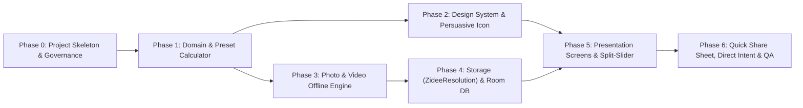

# Engineering Task Breakdown & Roadmap — Zidee Ress

Dokumen ini memecah pembangunan aplikasi **Zidee Ress** menjadi tahapan teknis (*Phases/Milestones*) dan tugas-tugas atomik (*Atomic Tasks*) yang terukur, lengkap dengan ketergantungan (*dependencies*) dan kriteria kelulusan (*Definition of Done*).

---

## Ringkasan Fase Pengembangan

---

## Phase 0: Project Skeleton, Multi-Module Gradle & Governance
**Tujuan:** Menyiapkan fondasi proyek Android Kotlin DSL yang bersih, konsisten, dan terdokumentasi penuh.

- [x] **T-0.1:** Penyusunan dokumentasi lengkap (`AGENTS.md`, `CLAUDE.md`, `DESIGN.md`, `PRD.md`, `SYSTEM_ARCHITECTURE.md`, `MEDIA_ENGINE_SPEC.md`, `TESTING_STRATEGY.md`, ADR).
- [x] **T-0.2:** Konfigurasi aturan AI Agent lokal (`.agents/rules/kotlin-android-ecc.md`) yang terintegrasi dengan plugin ECC.
- [x] **T-0.3:** Inisialisasi konfigurasi Gradle Kotlin DSL (`settings.gradle.kts`, `build.gradle.kts`, `gradle/libs.versions.toml`) untuk 7 modul: `:app`, `:core`, `:domain`, `:data`, `:media-engine`, `:design-system`, `:presentation`.
- [x] **T-0.4:** Konfigurasi `ktlint`, `detekt`, `kover`, serta JUnit 4 / Coroutines Test / Turbine di seluruh modul.
  - *DoD:* `./gradlew ktlintCheck detekt` dan unit test seluruh modul berjalan bersih tanpa galat.

---

## Phase 1: Core & Domain Layer (Pure Kotlin & Preset Matrix)
**Tujuan:** Membangun logika bisnis murni dan rumus perhitungan *Sweet-Spot* 5 platform beserta unit test 100%.

- [x] **T-1.1:** Implementasi tipe dasar di `:core` (`AppResult<T>`, `AppError`, `DispatcherProvider`, `MediaFormatters`).
- [x] **T-1.2:** Pembuatan model domain di `:domain`:
  - `TargetPlatform` (`WA_STORY`, `WA_CHAT`, `IG_STORY`, `IG_POST`, `IG_CHAT`)
  - `CanvasAspectMode` (`ORIGINAL`, `BLUR_BG_9_16`, `CROP_9_16`)
  - `PhotoAdvancedConfig` & `VideoAdvancedConfig` (Lanczos, Sharpness `0–100%`, FPS `30/60`, Encoder `CPU_LIBX264` / `GPU_MEDIACODEC`, HDR-to-SDR, Auto-Split `30s/60s`).
- [x] **T-1.3:** Implementasi `CalculateOptimalSpecUseCase`:
  - Menghitung dimensi target genap (modulo-2), posisi *crop/padding*, estimasi ukuran file MB, dan batas *bitrate* berdasarkan resolusi media asli dan platform tujuan.
- [x] **T-1.4:** Kontrak antarmuka `MediaOptimizerEngine`, `MediaStorageRepository`, dan `OptimizationHistoryRepository`.
- [x] **T-1.5:** Unit Test menyeluruh untuk seluruh kalkulasi dimensi dan *bitrate* di `:domain`.
  - *DoD:* Coverage `:domain` $\ge 90\%$ dan seluruh skenario rasio (`16:9`, `4:3`, `9:16`, `1:1`, `20:9`) menghasilkan piksel genap yang akurat.

---

## Phase 2: Design System ("Pro Darkroom Optics") & Launcher Icon
**Tujuan:** Membangun identitas visual *Obsidian Darkroom* + *Amber Gold (`#F59E0B`)* + *Crisp White (`#F8FAFC`)* serta komponen UI khusus.

- [x] **T-2.1:** Implementasi `ZideeTheme`, `ZideeColors`, `ZideeTypography` (dengan dukungan `tabular-nums`), dan radius konsentris di `:design-system`.
- [x] **T-2.2:** Pembuatan **Adaptive Launcher Icon `Zidee Ress`**:
  - Lensa kristal *split* (kiri piksel pecah $\rightarrow$ kanan fokus tajam Amber Gold) + **Badge Versi (`v1.0`)** di bagian bawah ikon.
- [x] **T-2.3:** Komponen reusable:
  - `PlatformPresetSelector` (5 pil target dengan indikator aktif Amber Gold).
  - `CanvasModeSegmentedControl` (`Rasio Asli` | `Blur BG 9:16` | `Crop 9:16`).
  - `BeforeAfterSplitSlider` (Garis geser kiri-kanan interaktif 120Hz dengan label *Asli* vs *Zidee Ress HD*).
  - `AdvancedParameterPanel` (Accordion & Slider dengan angka `tabular-nums`).
  - *DoD:* Seluruh komponen memiliki `@Preview` Compose dan mematuhi kontras aksesibilitas serta *touch target* $\ge 48\text{dp}$.

---

## Phase 3: Offline Media Processing Engine (`:media-engine`)
**Tujuan:** Mengimplementasikan mesin pemroses foto dan video lokal berkecepatan dan berketajaman tinggi.

- [x] **T-3.1:** **Photo Processing Pipeline:**
  - Pembacaan EXIF orientasi & konversi ruang warna lebar (*Display P3*) ke **sRGB 8-bit**.
  - Implementasi *downsampling* **Lanczos-3** ke dimensi target.
  - Kompositor kanvas `BLUR_BG_9_16` (*Gaussian Blur backdrop* + *sharp foreground centered*) dan `CROP_9_16`.
  - Filter **Smart Unsharp Mask** (*Anti-Blur Compensation*) sesuai persentase *slider*.
  - Penulisan JPEG berkualitas tinggi (`94%` default) dengan manajemen memori bebas `OutOfMemoryError`.
- [x] **T-3.2:** **Video Processing Pipeline (FFmpeg Builder & Runner):**
  - Generator argumen `filter_complex` FFmpeg untuk 3 mode rasio (`ORIGINAL`, `BLUR_BG_9_16`, `CROP_9_16`), scaling `flags=lanczos`, `fps=30`, `unsharp`, dan *tone-mapping* HDR-ke-SDR.
  - Dukungan 2 profil encoder: `libx264` (Kualitas Maksimal CPU) & `h264_mediacodec` (Cepat GPU).
  - Pemotong otomatis (*Segment Muxer* `-f segment -segment_time 30` / `60`) untuk WA/IG Story.
  - Parser *progress real-time* (mengubah `out_time_ms` dari FFmpeg menjadi persentase `0%–100%`).
- [x] **T-3.3:** Implementasi `MediaOptimizationForegroundService` dengan notifikasi progres dan tombol *Cancel*.
  - *DoD:* Pengujian pipeline menghasilkan foto dan video dengan resolusi, FPS, dan ruang warna yang tepat tanpa kebocoran file sementara di `cacheDir`.

---

## Phase 4: Permanent Storage (`ZideeResolution`) & Local Database (`:data`)
**Tujuan:** Menyimpan seluruh hasil ke folder Galeri permanen `ZideeResolution` dan mencatat riwayat di `Room`.

- [x] **T-4.1:** Implementasi `MediaStoreSaver`:
  - Menyimpan foto ke `Pictures/ZideeResolution` dan video ke `Movies/ZideeResolution` menggunakan mekanisme `IS_PENDING = 1` $\rightarrow$ tulis *stream* $\rightarrow$ `IS_PENDING = 0` + `MediaScannerConnection`.
- [x] **T-4.2:** Implementasi `Room` Database (`ZideeDatabase`, `OptimizationHistoryDao`, `OptimizationHistoryEntity`) untuk menyimpan riwayat file yang telah dioptimasi.
- [x] **T-4.3:** Implementasi `DataStore` untuk menyimpan pengaturan terakhir pengguna (platform terakhir, rasio favorit, pilihan encoder).
  - *DoD:* File yang selesai diproses langsung muncul di aplikasi Galeri HP di dalam album `ZideeResolution` baik dari alur penuh maupun alur cepat.

---

## Phase 5: Presentation Layer & Main Studio Screens (`:presentation`)
**Tujuan:** Menghubungkan `ViewModel` dengan layar-layar utama aplikasi.

- [x] **T-5.1:** `DashboardScreen` & `DashboardViewModel` (`HP 01`):
  - Kartu pemilih foto/video (*Photo Picker* tanpa izin invasif bila didukung OS), pintasan 5 platform, tab `Studio Utama` & `Album ZideeResolution`, dan daftar riwayat album `ZideeResolution` dengan fitur *1-Click Re-Share*.
- [x] **T-5.2:** `StudioEditorScreen` & `StudioEditorViewModel` (`HP 02`, `HP 03`, `HP 05`, `TAB 01`, `TAB 02`):
  - Kanvas interaktif (*Crop 9:16 pan & zoom*, pratinjau *Blur BG*, dan *Split-Slider Before/After*), kontrol *Target & Rasio*, overlay/tab `⚙️ Pengaturan Advanced Pro`, overlay render progres & hasil, serta tata letak responsif HP, Tablet Portrait 2-pane, dan Tablet Landscape 3-pane Workstation.
- [x] **T-5.3:** Unit test untuk seluruh `ViewModel` (`DashboardViewModel`, `StudioEditorViewModel`, `QuickShareViewModel`), `DomainUiMappers`, dan `DirectShareIntentRouter`/`IncomingShareExtractor` menggunakan `Turbine` dan `StandardTestDispatcher`.
  - *DoD:* Seluruh transisi *state* (`Loading`, `Empty`, `Error`, `Partial`, `Success`) teruji, `ktlintCheck` & `detekt` lolos tanpa isu.

---

## Phase 6: Quick Share Bottom Sheet, Direct Intent Router & Final QA
**Tujuan:** Menyelesaikan pengalaman *Share* langsung dari Galeri HP dan pengujian menyeluruh.

- [x] **T-6.1:** Implementasi `QuickShareActivity` & `QuickShareSheet` (`HP 04` + `HP 05`, bertema transparan `Theme.ZideeRess.BottomSheet`) yang menangkap `ACTION_SEND` dan `ACTION_SEND_MULTIPLE` (`image/*`, `video/*`) dari Galeri HP beserta handoff URI ke `MainActivity`.
- [x] **T-6.2:** Integrasi `DirectShareIntentRouter` di `MainActivity` dan `QuickShareActivity`:
  - Meneruskan URI `MediaStore` (`ZideeResolution`) langsung ke `com.whatsapp`, `com.whatsapp.w4b`, atau `com.instagram.android` dengan `FLAG_GRANT_READ_URI_PERMISSION`, disertai *fallback* ke *system chooser* jika aplikasi tujuan belum terpasang.
- [x] **T-6.3:** Validasi MIME media ketat di `IncomingShareExtractor`, aturan R8/ProGuard rilis (`proguard-rules.pro`), `ktlintCheck`, `detekt`, `lintDebug`, 145 unit tests, serta verifikasi APK `debug` & `release` bertandatangan SHA-1 identik (`b085af4ad6820c4b2ce8636c297752c6cf8d83f0`).
  - *DoD:* APK debug dan rilis (`minifyEnabled = true`, `shrinkResources = true`) lolos build & `apksigner verify` dengan sertifikat yang sama; alur lengkap siap uji coba di perangkat fisik / emulator.
