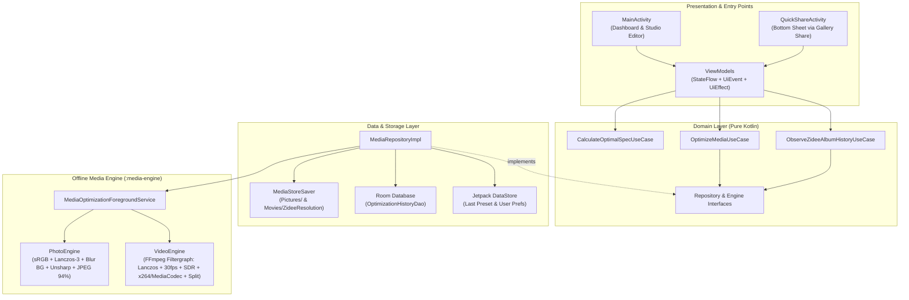
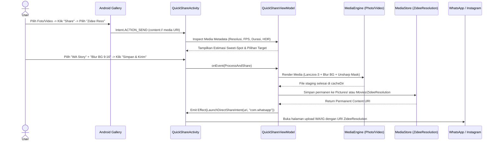

# System Architecture — Zidee Ress

Dokumen ini menjelaskan arsitektur tingkat tinggi, pemisahan modul **Clean Architecture**, aliran data *Unidirectional Data Flow (UDF)*, serta orkestrasi pemrosesan media lokal pada **Zidee Ress**.

---

## 1. Gaya Arsitektur Utama

1. **100% On-Device Clean Architecture:** Seluruh lapisan (`presentation`, `domain`, `data`, `media-engine`) berjalan secara lokal di dalam perangkat Android tanpa ketergantungan jaringan.
2. **Unidirectional Data Flow (MVI / UDF):** Setiap layar dikendalikan oleh satu aliran `StateFlow<UiState>` yang *immutable*, menerima aksi pengguna melalui `onEvent(UiEvent)`, dan memancarkan efek satu-kali (*one-shot side effects* seperti membuka *Share Intent* ke WA/IG) melalui `Channel<UiEffect>`.
3. **Foreground-Guaranteed Media Pipeline:** Pemrosesan video atau *batch* foto dieksekusi di dalam `MediaOptimizationForegroundService` agar dijamin selesai meskipun pengguna berpindah aplikasi atau menggunakan perangkat berspesifikasi rendah.

---

## 2. Diagram Arsitektur Sistem

---

## 3. Alur Eksekusi Utama (Sequence Flow)

### 3.1. Alur Jalur Cepat (*Quick Share Bottom Sheet* $\rightarrow$ Album `ZideeResolution` $\rightarrow$ WA/IG)

---

## 4. Manajemen Concurrency & Threading (`DispatcherProvider`)

Seluruh operasi asinkron menggunakan `DispatcherProvider` yang diinjeksikan agar mudah diganti dengan `StandardTestDispatcher` saat pengujian:

| Dispatcher | Penggunaan di Zidee Ress |
| :--- | :--- |
| `Dispatchers.Main.immediate` | Pembaruan `StateFlow` di `ViewModel`, animasi *Split-Slider*, dan navigasi UI. |
| `Dispatchers.Default` | Perhitungan matriks dimensi, pemrosesan piksel *Bitmap/OpenCV* di CPU, dan generasi pratinjau *Unsharp Mask*. |
| `Dispatchers.IO` | Pembacaan metadata `MediaExtractor`/`ExifInterface`, penulisan file ke `MediaStore` (`ZideeResolution`), kueri `Room`, dan eksekusi proses `FFmpeg`. |

---

## 5. Penanganan Error Terstruktur (`AppError`)

Tidak ada *exception* mentah yang boleh bocor ke lapisan UI. Semua kegagalan dipetakan ke `sealed interface AppError`:
- `AppError.SourceUnreadable`: URI dari Galeri tidak dapat dibuka atau izin kadaluarsa.
- `AppError.UnsupportedFormat`: File rusak atau codec tidak dikenali.
- `AppError.InsufficientStorage(requiredMb: Long)`: Ruang penyimpanan HP kurang untuk menyimpan hasil ke `ZideeResolution`.
- `AppError.EngineExecutionFailed(stage: String, reason: String)`: Kegagalan pada tahap pemrosesan foto/FFmpeg.
- `AppError.TargetAppNotInstalled(packageName: String)`: Aplikasi WA/IG belum terpasang (otomatis memicu *fallback* ke menu *Share* bawaan Android).
